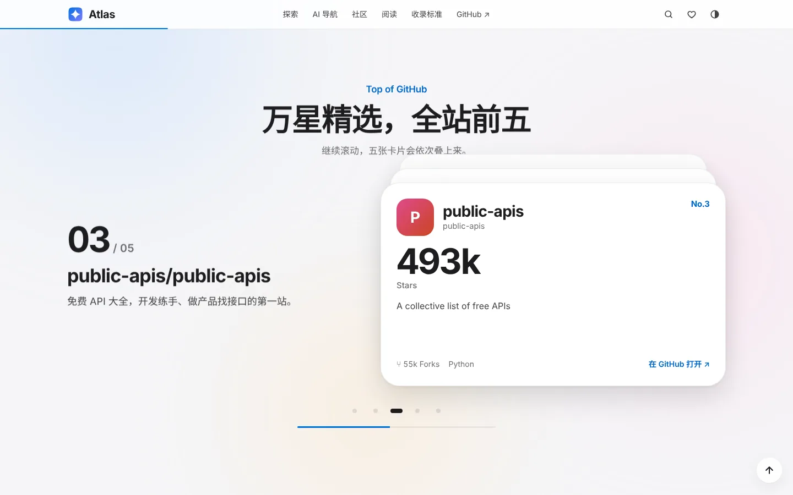
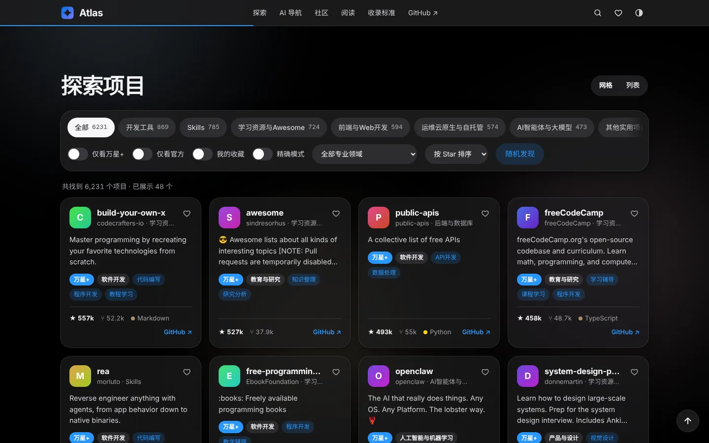
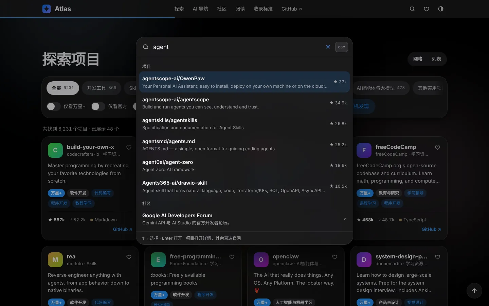
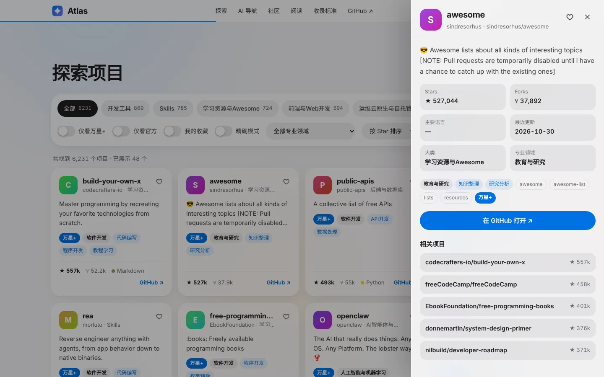
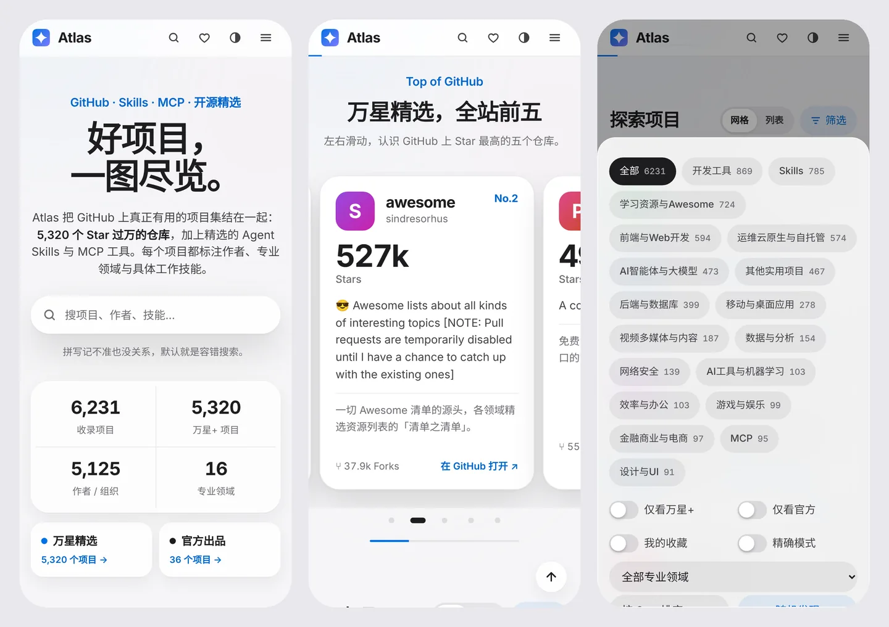

<p align="center">
  
</p>

<h1 align="center">Atlas</h1>

<p align="center">
  <b>GitHub 上值得收藏的项目，一图尽览。</b><br>
  5,320 个万星仓库 + 精选 Agent Skills、MCP 与 AI 工具，共 6,231 个，全部标注作者、专业领域与工作技能。
</p>

<p align="center">
  <a href="https://liveliho.github.io/atlas/"><b>🌐 在线访问</b></a> ·
  <a href="#功能">功能</a> ·
  <a href="#收录标准">收录标准</a> ·
  <a href="#本地运行">本地运行</a> ·
  <a href="https://github.com/liveliho/atlas/issues">推荐收录 / 反馈</a>
</p>

<p align="center">
  
  
  
  
  
</p>

<p align="center">
  <a href="https://liveliho.github.io/atlas/"></a>
</p>

## 这是什么

GitHub 上有几亿个仓库，好东西总是被淹没。Atlas 把其中**真正有用**的部分捞出来，做成一个可搜索、可筛选的图鉴：

- **万星+ 仓库（5,320 个）**：全站 Star 过万的非 Fork、未归档仓库共 5,399 个，收录其中有完整简介的 5,320 个，一键只看它们
- **MCP 服务器与插件**：Model Context Protocol 官方实现，以及数据库、浏览器、设计工具的 MCP Server
- **Agent Skills 技能**：Anthropic 官方 Skills，Claude Code / Codex / Cursor 等智能体的技能包与插件
- **AI 智能体与机器学习**：Agent 框架、RAG、LLM 工具链、推理服务与 ML 框架
- **开发 / 前端 / 后端 / 运维**，以及安全、数据、设计、多媒体、金融、移动、游戏、学习资源与 Awesome 清单，共 18 个大类

每个项目都带**作者头像、简介、Star / Fork、主要语言、标签与 GitHub 直达链接**，并标注**专业领域**（软件开发、市场营销、网络安全、金融与交易、法律与合规、医疗健康等 16 类）与**具体工作技能**（如 SEO 优化、渗透测试、合同审查）。官方组织的出品带「官方」徽章。

## 功能

### 苹果产品页式的滚动

<p align="center"></p>

- **首屏景深**：标题区被钉住，十张高星仓库卡片按各自的深度向四周飞散，鼠标移动时有轻微视差；背景光晕随整页滚动缓慢漂移
- **逐句点亮**：一段宣言文字随滚动一句一句亮起来
- **前五名叠卡**：滚到「万星精选」时画面钉住，Star 前五的仓库卡片一张张叠上来，旧卡片后退变暗，左侧文案同步切换；手机上变成可左右滑动的卡片
- **分档与降级**：宽屏完整编排，手机减幅视差，系统开启「减少动态效果」时完全静止；即使脚本加载失败，内容也完整可用

<table>
  <tr>
    <td width="50%"></td>
    <td width="50%"></td>
  </tr>
  <tr>
    <td align="center">万星精选 · 前五名叠卡</td>
    <td align="center">探索项目 · 深色主题</td>
  </tr>
  <tr>
    <td width="50%"></td>
    <td width="50%"></td>
  </tr>
  <tr>
    <td align="center"><code>⌘K</code> 全站搜索</td>
    <td align="center">项目详情 + 相关项目</td>
  </tr>
</table>

### 找项目

- **容错搜索**：子序列匹配 + 单字符拼写容错 + 名称加权，记不准拼写也能搜到；另有「精确模式」
- **`⌘K` / `Ctrl+K` 命令面板**：一次搜遍项目、AI 导航、社区、博客与论文，↑↓ 选择、Enter 打开
- **筛选**：18 个大类、16 个专业领域、仅看万星+ / 官方 / 我的收藏，按 Star、Fork、更新时间、名称排序，还有「随机发现」
- **可分享**：搜索与筛选状态同步到网址，复制链接即可还原
- **收藏**：本地保存，顶栏显示数量
- **精选合集**：万星精选、官方出品、AI 智能体、Skills 技能库、学习路线、安全工具箱

### 站内专区

- **AI 导航**：32 个国内外主流 AI 产品，ChatGPT、Claude、Gemini、DeepSeek、豆包、Kimi、Midjourney、可灵、Cursor、Perplexity 等，整卡直达官网
- **AI 论坛社区**：Hugging Face 论坛、r/LocalLLaMA、Hacker News，以及 Linux DO、魔搭、WaytoAGI、Datawhale、机器之心等 18 个社区
- **AI 阅读**：官方博客与经典长文、12 篇地标论文（全部 arXiv 直达）、14 张知识点卡片

### 手机上同样好用

<p align="center"></p>

导航收进菜单，筛选进底部面板，前五名变成滑动卡片；触控目标 ≥ 44px，适配刘海与底部安全区，输入框 16px 防止 iOS 自动放大。360 到 1440 px 六档宽度验证无横向溢出。

## 收录标准

1. **万星专区**：Stars > 10,000、非 Fork、未归档、简介清晰，按 Star 区间切片穷尽抓取
2. **有用才收录**：其余精选项目原则上 Star ≥ 600；垂类专业 Skill 受众小、星标天然低，放宽到 20 起，同样要求简介清晰
3. **去伪存真**：剔除 Fork 镜像与已归档项目
4. **按实分类**：依据项目名称与简介的真实内容分类，而不是容易被刷的 Topic 标签；有显式纠错表与回归测试把关
5. **数据可复现**：抓取、分类与构建脚本都在 [`scripts/`](scripts/)

## 本地运行

纯静态站点，没有构建步骤：

```bash
python3 -m http.server 8000
# 打开 http://localhost:8000
```

## 项目结构

```
index.html            页面结构（首屏卡片、前五名叠卡为静态 HTML，无 JS 也能看）
assets/
  app.js              项目库：数据加载、搜索、筛选、收藏、详情抽屉、⌘K 面板、主题
  extras.js           AI 导航 / 社区 / 阅读三个专区的数据与渲染
  motion.js           滚动编排（无第三方依赖，可整体移除）
  style.css           设计系统与全部样式
data/
  index.json          站点加载的紧凑索引（单请求，约 2.3 MB）
  projects.json       完整数据（含全部 topics 等字段），index.json 由它生成
scripts/              数据抓取、分类、构建与测试脚本
docs/images/          README 截图与社交分享图
```

## 更新数据

需要可用的 GitHub 搜索通道（脚本里的 CLI 路径按你的环境修改）：

```bash
python3 scripts/collect.py              # 按主题大规模搜索
python3 scripts/collect2.py             # 补官方种子项目并按名称/简介重新分类
python3 scripts/collect3.py             # 按职业领域定向扩收各类 Skill
python3 scripts/classify_fields.py      # 标注专业领域与具体工作技能
python3 scripts/merge_over10k.py        # 并入万星项目（18 大类体系）
python3 scripts/test_classification.py  # 分类回归测试
python3 scripts/build_index.py          # 由 data/projects.json 生成 data/index.json
```

## 测试与截图

```bash
pip install playwright pillow && python3 -m playwright install chromium
python3 scripts/smoke_test.py      # 端到端冒烟测试：搜索、面板、抽屉、收藏、主题、手机端、溢出、减少动态
python3 scripts/screenshots.py     # 重新生成 docs/images/ 下的截图
```

## 技术

原生 HTML / CSS / JS，零依赖、无框架、无构建。

- **滚动引擎**：钉住用 CSS `position: sticky`，每帧读取各段落在视口中的位置换算为进度，再以时间插值平滑追随，只写 `transform` / `opacity`；动画只在有变化时运行，静止时不占 CPU
- **数据**：只拉一个紧凑索引，失败自动重试 3 次；页脚显示数据快照时间
- **渲染**：卡片增量追加，滚动自动加载前几页后改为按钮加载，保证下方专区可达
- **头像兜底**：GitHub 头像加载失败时显示带色彩的首字母方块，不会出现破图
- **主题**：浅色 / 深色 / 跟随系统，首帧前确定，无闪烁

## 许可

站点代码以 MIT 许可开放（见 [LICENSE](LICENSE)）；收录项目的版权与许可归各自作者所有，本站仅做索引与链接。
